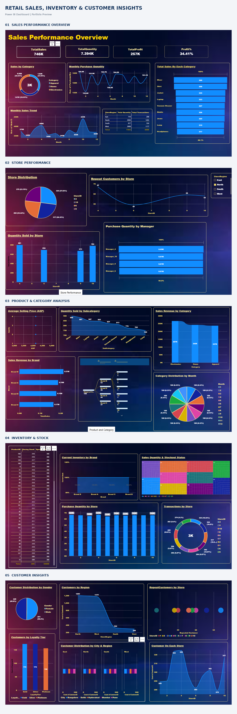
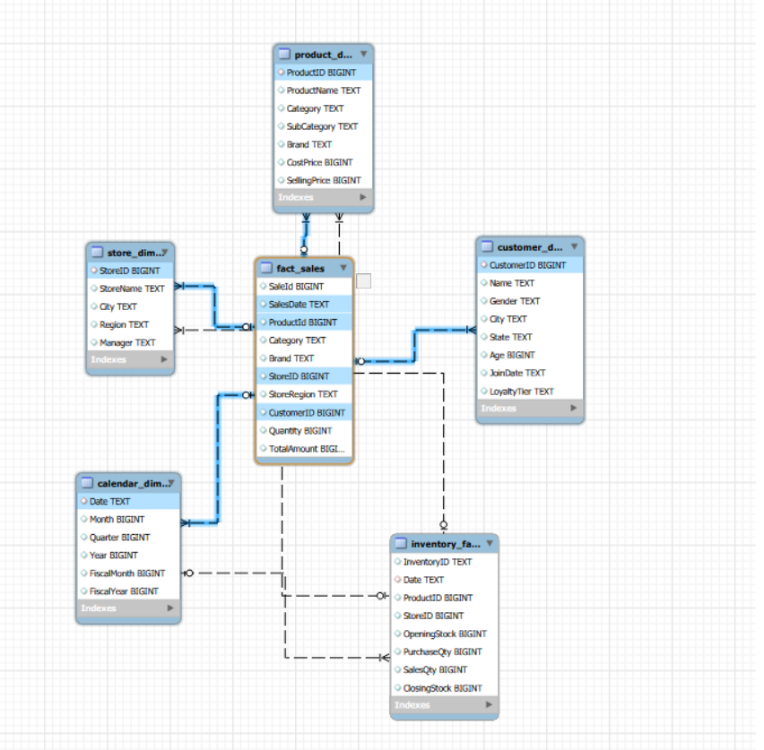

# Retail Sales, Inventory & Customer Insights

A retail analytics project that combines MySQL data preparation and analysis with a five-page Power BI dashboard. It explores sales performance, stores, products, inventory, and customer behavior.



## Dashboard

The Power BI report ([Retail dashboard.pbix](Retail%20dashboard.pbix)) contains:

1. **Sales Performance Overview** — sales, quantity, profit, category mix, and monthly trends.
2. **Store Performance** — store distribution, quantities sold, and repeat customers by store.
3. **Product & Category Analysis** — selling price, subcategory volume, and revenue by category and brand.
4. **Inventory & Stock** — stock levels, sales and stock status, and purchase quantities.
5. **Customer Insights** — customer demographics, regions, loyalty tiers, and repeat purchases.

Open the PBIX file with Power BI Desktop to explore the report. The screenshots [retail_analytics_dashboard_all_pages.png](retail_analytics_dashboard_all_pages.png) and [retail_analytics_readme_gallery.png](retail_analytics_readme_gallery.png) provide previews.

## Project files

| File or folder | Description |
| --- | --- |
| `Data/` | CSV exports for the calendar, customer, product, store, sales, and inventory tables. |
| `ETL process.sql` | MySQL examples for cleaning, joining, aggregating, KPI analysis, and data-quality checks. |
| `export_data.ipynb` | Notebook that reads the CSV files and loads them into MySQL. |
| `Retail dashboard.pbix` | Power BI report. |
| `EER.png` | Entity-relationship diagram. |
| `Relation between the tables (EER).mwb` | MySQL Workbench model file. |

### Data tables

| CSV | Rows | Contents |
| --- | ---: | --- |
| `Calendar_Dim.csv` | 366 | Calendar and fiscal date attributes |
| `Customer_Dim.csv` | 500 | Customer profile, location, and loyalty tier |
| `Product_Dim.csv` | 180 | Product, category, brand, and prices |
| `Store_Dim.csv` | 10 | Store, location, region, and manager |
| `Sales_Fact.csv` | 3,000 | Sales transactions, quantity, and discount |
| `Fact_sales.csv` | 3,000 | Sales analysis table with product and store attributes |
| `Inventory_Fact.csv` | 65,880 | Daily inventory quantities by product and store |

## Run locally

### Requirements

- MySQL Server and a MySQL client such as MySQL Workbench
- Python and Jupyter Notebook
- Python packages used by the notebook: `pandas`, `mysql-connector-python`, `SQLAlchemy`, and `PyMySQL`
- Power BI Desktop (to open the report)

### Load the CSV data into MySQL

1. Create a MySQL database named `Retail`.
2. Install the notebook packages if needed:

   ```bash
   pip install pandas mysql-connector-python sqlalchemy pymysql
   ```

3. Open `export_data.ipynb`. Set its connection details to your own local MySQL host, username, and password. Do not commit credentials.
4. Run the notebook cells. It reads the CSVs from `Data/` and writes the tables to the `Retail` database.

> **Caution:** The notebook loads tables with `if_exists="replace"`, which replaces tables with the same names in the database.

### Run the SQL analysis

Open `ETL process.sql` in a MySQL client and execute the analysis statements against the loaded tables. If the database already exists, skip or adjust the initial `CREATE DATABASE RETAIL;` statement before running the rest of the script. The SQL file includes examples for standardization, null handling, joins, date attributes, sales aggregations, business KPIs, and validation queries.

## Data model

The project uses calendar, customer, product, and store dimensions alongside sales and inventory fact tables.


