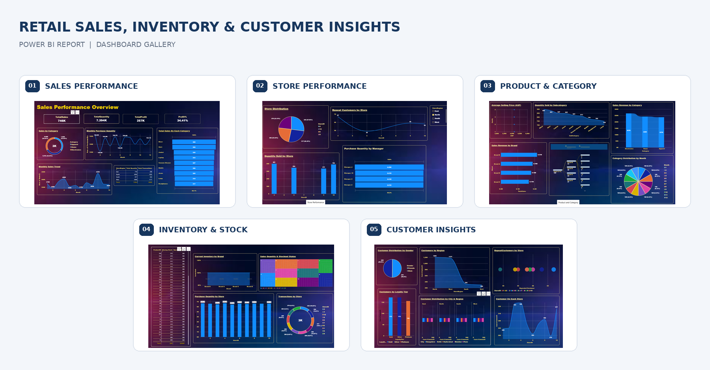

# Retail Sales, Inventory & Customer Behaviour Analysis

## 📌 Project Overview

The **Retail Sales, Inventory & Customer Behaviour Analysis** project is an end-to-end data analytics and business intelligence solution designed to analyze retail business operations, evaluate sales performance, optimize inventory management, and understand customer purchasing behaviour.

The project uses multiple datasets covering sales transactions, product information, customer demographics, store operations, and inventory records to identify meaningful business patterns and performance trends.

Using **MySQL, Python, Excel, and Power BI**, this project transforms raw retail data into structured information, performs business-oriented analysis, and presents actionable insights through interactive dashboards.

The primary objective is to help retail businesses understand what is happening across their operations, identify potential business challenges, and make informed, data-driven decisions.

---

## 🎯 Business Problem

Retail businesses generate large amounts of data through sales transactions, inventory operations, customer purchases, and store activities. However, managing this information separately makes it difficult to understand overall business performance.

Some common challenges faced by retail businesses include:

- **Sales Performance:** Difficulty identifying revenue trends, profitable categories, and top-performing products.
- **Inventory Management:** Maintaining appropriate stock levels while avoiding overstocking and stockout situations.
- **Customer Behaviour:** Understanding customer purchasing patterns, loyalty levels, and repeat purchase behaviour.
- **Store Performance:** Comparing the performance of different stores, regions, and operational activities.
- **Business Reporting:** Difficulty converting raw operational data into meaningful business insights.

This project addresses these challenges by integrating multiple retail datasets and developing an analytical reporting solution.

---

## 🎯 Project Objectives

The main objectives of this project are:

1. Analyze overall sales performance and identify revenue trends across different periods.
2. Evaluate product and category performance to identify high-performing and low-performing products.
3. Analyze store-wise and region-wise sales performance.
4. Monitor inventory levels and identify potential stockout situations.
5. Understand customer demographics, purchasing patterns, and loyalty distribution.
6. Analyze repeat customer behaviour and customer distribution across different regions.
7. Develop business KPIs to measure sales growth, profitability, and inventory performance.
8. Build interactive Power BI dashboards to communicate findings effectively.


## 🛠️ Technologies & Tools Used

| Technology | Purpose |
|---|---|
| MySQL | Data storage, SQL querying, joins, aggregations, and business analysis |
| Python | Data loading and database integration |
| Pandas | Data handling and processing |
| Microsoft Excel | Initial data inspection and analysis |
| Power BI | Interactive dashboards and business reporting |
| Power Query | Data cleaning and transformation |
| DAX | Calculated measures, KPIs, and business metrics |

---

## 📊 Power BI Dashboard & Analysis

The Power BI report consists of five interactive dashboard pages. Each page focuses on a different aspect of retail business performance.

### 1. Sales Performance Overview

This dashboard provides an overview of the company's overall sales performance and profitability.

**Key Analysis:**

- Total Sales: Measures the overall revenue generated.
- Total Quantity: Evaluates the total quantity of products sold.
- Total Profit: Measures the profit generated from sales.
- Profit Margin: Evaluates profitability as a percentage of sales.
- Category-wise Sales: Analyzes the contribution of different product categories.
- Monthly Sales Trends: Identifies changes in sales performance across different months.
- Subcategory Analysis: Compares transaction volumes across product subcategories.
- Regional Performance: Compares total quantity and transactions across store regions.

**Business Purpose:**

Helps management understand overall business performance, identify sales trends, and evaluate which product categories contribute to revenue generation.

### 2. Store Performance Analysis

This dashboard focuses on evaluating store-level performance and operational activities.

**Key Analysis:**

- Store Distribution: Examines the distribution of transactions across stores.
- Quantity Sold by Store: Compares product sales quantities across different locations.
- Repeat Customers by Store: Evaluates repeat customer activity across stores.
- Purchase Quantity by Manager: Analyzes purchase quantities associated with different store managers.
- Regional Filtering: Allows users to explore store performance by region.

**Business Purpose:**

Helps management compare store performance, understand customer activity, and identify differences in operational performance across locations.

### 3. Product & Category Analysis

This dashboard focuses on product performance, category contribution, and brand-level sales analysis.

**Key Analysis:**

- Average Selling Price (ASP): Evaluates the average selling price of products.
- Quantity Sold by Subcategory: Identifies subcategories with higher sales volumes.
- Sales Revenue by Category: Compares revenue contribution across product categories.
- Sales Revenue by Brand: Evaluates brand-wise revenue performance.
- Category Distribution by Month: Examines the distribution of categories across different months.

**Business Purpose:**

Helps businesses understand product demand, identify strong-performing brands, evaluate category contributions, and support product-level planning.

### 4. Inventory & Stock Analysis

This dashboard focuses on inventory monitoring and stock-related activities.

**Key Analysis:**

- Current Inventory by Brand: Examines inventory levels across different brands.
- Sales Quantity & Stockout Status: Analyzes sales quantities alongside stockout information.
- Opening Stock: Examines the stock available at the beginning of the period.
- Closing Stock: Evaluates the remaining stock at the end of the period.
- Purchase Quantity by Store: Compares purchasing activity across stores.
- Transactions by Store: Examines transaction distribution across different stores.

**Business Purpose:**

Helps businesses monitor stock availability, identify potential inventory issues, understand purchasing patterns, and improve inventory planning.

### 5. Customer Behaviour Analysis

This dashboard focuses on understanding customer demographics, loyalty, and purchasing behaviour.

**Key Analysis:**

- Customer Distribution by Gender: Analyzes the distribution of customers across gender categories.
- Customers by Region: Compares customer distribution across different geographical regions.
- Repeat Customers by Store: Examines repeat customer activity across stores.
- Customers by Loyalty Tier: Analyzes customers across Gold, Silver, and Platinum loyalty categories.
- Customer Distribution by City & Region: Examines customer distribution across different cities and regions.
- Customer Count by Store: Compares customer distribution across individual stores.

**Business Purpose:**

Helps businesses understand customer characteristics, evaluate loyalty program distribution, identify repeat purchasing patterns, and support customer retention strategies.

---

## 📸 Dashboard Preview

The following image provides an overview of all five Power BI dashboard pages.



**Power BI Report:** `Retail dashboard.pbix`

Open the Power BI file using Power BI Desktop to explore the complete interactive report.

---

## 🔄 Data Analytics Workflow

The project follows a structured data analytics workflow, starting from raw data preparation and ending with interactive business reporting.

### Step 1: Data Collection

Collected multiple retail datasets containing information about sales transactions, products, customers, stores, calendar attributes, and inventory records.

### Step 2: Data Loading

Used Python and Pandas to read CSV datasets and load the data into a MySQL database for further analysis.

### Step 3: Data Cleaning & Preparation

Performed data quality checks to identify missing values, duplicate records, inconsistent formats, and other data-related issues.

Prepared the datasets to ensure consistency and reliability during analysis.

### Step 4: SQL Data Analysis

Used MySQL to perform:

- Data exploration and inspection.
- Data cleaning and standardization.
- NULL value identification and handling.
- Duplicate record identification.
- Joins across multiple tables.
- Aggregations and grouping.
- Sales and profit analysis.
- Product and category analysis.
- Store and customer analysis.
- Business KPI calculations.

### Step 5: Data Modelling

Designed a dimensional data model using fact and dimension tables.

The model includes sales and inventory fact tables along with Calendar, Customer, Product, and Store dimension tables.

### Step 6: Power BI Development

Connected the prepared data to Power BI and used Power Query for data transformation.

Created DAX measures to calculate business KPIs and developed five interactive dashboard pages to visualize the analytical results.

### Step 7: Business Insights

Analyzed the dashboard results to understand sales performance, product contribution, inventory conditions, store activities, and customer purchasing behaviour.

---

## 🧮 SQL Analysis & Business KPIs

The SQL analysis focuses on extracting meaningful information from retail datasets and answering business-related questions.

**Areas of SQL Analysis:**

- Data exploration and data quality checks.
- Filtering and sorting records.
- Aggregate functions.
- GROUP BY and HAVING clauses.
- INNER JOIN, LEFT JOIN, and other joins.
- Subqueries and Common Table Expressions (CTEs).
- Date-based analysis.
- Sales and profit calculations.
- Product and category performance.
- Customer and store analysis.

**Business Metrics:**

| KPI | Description |
|---|---|
| Total Sales | Overall sales revenue generated |
| Total Profit | Total profit generated from sales |
| Profit Margin | Profit as a percentage of sales revenue |
| Total Quantity | Total units sold |
| Total Transactions | Number of sales transactions |
| YoY Growth | Performance comparison with the previous year |
| MoM Growth | Performance comparison with the previous month |
| Inventory Days of Cover | Estimated number of days current inventory can meet demand |
| ABC Analysis | Classification of inventory based on business importance or value |

---

## 🏗️ Data Modelling & Database Design

The project uses a dimensional modelling approach to organize retail data and support analytical reporting.

The data model consists of the following tables:

**Fact Tables:**

- `Sales_Fact`: Contains sales transaction information.
- `Inventory_Fact`: Contains inventory-related information.

**Dimension Tables:**

- `Calendar_Dim`: Contains calendar and date-related attributes.
- `Customer_Dim`: Contains customer information and loyalty details.
- `Product_Dim`: Contains product, category, brand, and pricing information.
- `Store_Dim`: Contains store locations, regions, and manager information.

The fact and dimension tables are connected through relationships to support cross-functional analysis.

### Entity Relationship Diagram


**Database Model File:** `Relation between the tables (EER).mwb`

---

## 📂 Dataset Description

The project uses multiple CSV files representing different retail business entities.

| Dataset | Records | Description |
|---|---:|---|
| Calendar_Dim.csv | 366 | Calendar and fiscal date attributes |
| Customer_Dim.csv | 500 | Customer profiles, locations, and loyalty tiers |
| Product_Dim.csv | 180 | Product details, categories, brands, and prices |
| Store_Dim.csv | 10 | Store locations, regions, and managers |
| Sales_Fact.csv | 3,000 | Sales transactions, quantities, and discounts |
| Fact_sales.csv | 3,000 | Sales analysis data containing product and store attributes |
| Inventory_Fact.csv | 65,880 | Daily inventory quantities by product and store |

---

## 📁 Project Structure

```text
Retail-Sales-Inventory-and-Customer-Insights/
│
├── Data/
│   ├── Calendar_Dim.csv
│   ├── Customer_Dim.csv
│   ├── Product_Dim.csv
│   ├── Store_Dim.csv
│   ├── Sales_Fact.csv
│   ├── Fact_sales.csv
│   └── Inventory_Fact.csv
│
├── ETL process.sql
├── export_data.ipynb
├── Retail dashboard.pbix
├── EER.png
├── Relation between the tables (EER).mwb
├── retail_analytics_readme_gallery.png
└── README.md
```

---

## ⚙️ Installation & Setup

Follow these steps to run the project locally.

### Prerequisites

Make sure the following tools are installed:

- MySQL Server
- MySQL Workbench
- Python 3.x
- Jupyter Notebook
- Power BI Desktop

### 1. Clone the Repository

```bash
git clone https://github.com/Amandeep006/Retail-sales-Inventory-and-Customer-Insights-analysis-.git
```

Navigate to the project directory:

```bash
cd Retail-sales-Inventory-and-Customer-Insights-analysis-
```

### 2. Install Python Dependencies

Install the required Python packages:

```bash
pip install pandas mysql-connector-python sqlalchemy pymysql
```

### 3. Create the MySQL Database

Open MySQL Workbench and execute:

```sql
CREATE DATABASE Retail;
```

### 4. Load CSV Data into MySQL

1. Open `export_data.ipynb` in Jupyter Notebook.
2. Configure your local MySQL connection details.
3. Verify the CSV file paths.
4. Execute the notebook cells to load the datasets into MySQL.

**Note:** The notebook uses `if_exists="replace"`, which replaces existing tables with the same names. Review this behaviour before running it against an existing database.

### 5. Execute SQL Analysis

1. Open `ETL process.sql` in MySQL Workbench.
2. Select the `Retail` database.
3. Execute the SQL statements.
4. Explore the data cleaning, transformation, and business analysis queries.

If the database already exists, skip or adjust the initial database creation statement.

### 6. Open the Power BI Dashboard

1. Open `Retail dashboard.pbix` using Power BI Desktop.
2. Configure the required data connections if prompted.
3. Explore all five dashboard pages.
4. Use the available filters and visualizations to analyze retail performance.

**Security Note:** Use your own local database credentials. Never upload passwords or sensitive connection details to GitHub.

---

## 📈 Key Learning Outcomes

Through this project, I gained practical experience in:

- Working with multiple relational datasets.
- Writing SQL queries for business analysis.
- Data cleaning and transformation.
- Understanding fact and dimension tables.
- Implementing dimensional data modelling.
- Creating DAX measures and business KPIs.
- Developing interactive Power BI dashboards.
- Analyzing sales, inventory, and customer behaviour.
- Translating business requirements into meaningful analytical insights.

This project strengthened my understanding of how data analytics can be applied to real-world retail business problems.

---

## 👨‍💻 Author

**Amandeep Saini**

Aspiring Data Analyst | SQL | Python | Power BI | Excel

- GitHub: [Amandeep006](https://github.com/Amandeep006)
- LinkedIn: [Connect with me](https://www.linkedin.com/in/amandeep-saini-5bb3842b7/)

---

⭐ If you find this project useful, consider giving this repository a star!
